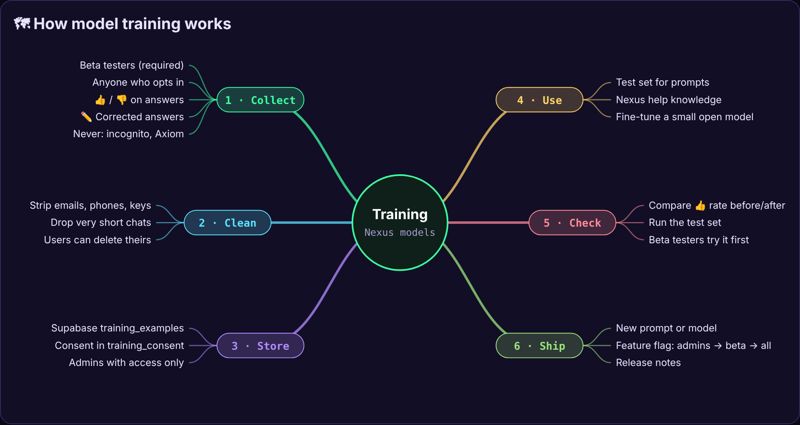

<p align="center"></p>

# Apoji Admin

The admin app for **Nexus '28** and **N28C**.
A Mac and Windows app (download it from Releases) and a website (GitHub Pages) that works from any browser or phone.

Only accounts in `public.admin_roles` can use it. Everything goes through Supabase row-level security.

## Mac app

Download the latest **Apoji-Admin-…-arm64.dmg** (Apple silicon) or **…-x64.dmg** (Intel) from [Releases](https://github.com/apojidelegraphics/Apoji-Admin/releases/latest), drag it to Applications, then run once:
```
xattr -cr "/Applications/Apoji Admin.app"
codesign --force --deep --sign - "/Applications/Apoji Admin.app"
```
It's the same portal with the files built in, plus a Dock badge for unread items, desktop notifications and an update check (Help → Check for Updates). To publish a new version, bump `version` in `package.json`, then push a tag like `v1.0.1`; GitHub Actions builds it and makes the release.

## What's inside

- **Dashboard**: active people (Mac & PC app vs N28C), new accounts, Shared Space posts, versions in use, top agents, who's online and a live activity feed.
- **Admin chat**: pinned messages, group chats, DMs, images and files, replies, reactions, edits, @mentions, read receipts (with an off switch) and online / idle / do-not-disturb / invisible status. **End-to-end encrypted**; see below.
- **Inbox**: beta requests, feedback and bug reports (reply to people in their app, internal notes, assign, prioritize), and content reports.
- **Users**: search, filters, bulk beta/comp, CSV export, profiles with private notes, history, suspend/ban and roles.
- **Moderation**: every Shared Space, post and shared agent.
- **App control**: feature flags, announcements and maintenance switches the apps enforce.
- **Tasks**: the team's to-do board (To do · Doing · Done) with owners, due dates and priorities, linked to feedback, users or reports. Drag cards between columns.
- **Command palette**: ⌘K / Ctrl+K jumps to any page, admin, user, feedback report or task. `G` then a letter goes to a page, `N` makes a task, `?` lists every shortcut.
- **Saved replies**: your own snippets for feedback replies and chat ().
- **Notifications**: pop-ups, desktop notifications, a chime and an app badge. Phone notifications through your Mac hub (below).
- **Team notes**: playbooks and how-tos, end-to-end encrypted like the chat, saved as you type, with a markdown preview and no silent overwrites.
- **Broadcasts**: a notification in everyone's Nexus app (Mac and PC) and N28C (everyone, beta testers, admins or people on older versions), now or later.
- **Schedules**: turn announcements, maintenance and feature flags on or off at a set time.
- **Health**: Supabase speed, live updates, the desktop hub, N28C requests waiting, failed schedules, free AI key credit, database and storage size.
- **Releases**: downloads from GitHub, which versions people run and a one-click "please update" broadcast, plus **Email the changelog**: send each release's notes to everyone who opted in, with EmailJS (high-admins; needs `supabase/nexus-v2.7.sql` from the Nexus repo). Setup is in the Nexus repo under `docs/EMAILJS.md`.
- **Status page**: post incidents and updates to the public Nexus status page, and override any component.
- **Axiom (Apex)**: high-admins only. Take Axiom offline (now, for a while or until you bring it back, with a message), switch tool kits off for everyone, read-only mode, block people or give them their own minutes, reset minutes, latest turns, prompt history with restore, who can use it, weekly minutes, providers and its prompt (stored only in Supabase).
- **Audit alerts**: a notification when another admin changes roles, bans someone or removes content.

## Mac hub (Tailscale)

Supabase stays the source of truth, so the website and the Mac app both work from anywhere. Turn on **This Mac → Use this Mac as the hub** and that Mac also:

- runs a small private API on your **tailnet only** (`tailscale serve` on port 8443, with a real HTTPS certificate). Every call needs a Tailscale account (optionally from an allow list) **and** a signed-in Apoji admin;
- sends **phone notifications** (web push from your Mac; phones only see "New message in #room" for chat unless you allow the text);
- runs **schedules** on time (every 30 seconds) and stays **awake**, on battery too down to 20% (or only while plugged in, if you like). The screen can still turn off, or stay on and dim after a while away;
- opens at login and lives in the menu bar when you close the window (⌘Q quits).

The website finds the hub by itself. On a phone with Tailscale on, open the website → **Mac hub** → **Turn on notifications** (on iPhone, add the site to your Home Screen first). From there you can also run schedules right away and see what's new on the Mac. Without a hub, schedules run whenever any Apoji Admin is open.

Setup: install [Tailscale](https://tailscale.com/download) on the Mac and your phone (same account), and in the Tailscale admin console → DNS turn on **MagicDNS** and **HTTPS Certificates**.

## Encrypted admin chat

Messages and files are encrypted in your browser before they're sent (AES-256-GCM with a key derived from the team passphrase, PBKDF2-SHA-256 with 600,000 rounds). Supabase only stores scrambled text. Nobody can read the chat in the table editor, in backups or through the API without the passphrase, and the database refuses unencrypted messages.

- A high-admin sets the team passphrase the first time anyone opens Admin chat. Share it with admins in person.
- Each device asks for it once and keeps the key in that browser. *My settings → Lock* forgets it.
- *My settings → Encrypt messages from before* encrypts messages and files sent before encryption was turned on.
- If the passphrase is lost, encrypted messages can't be recovered by anyone.

## Setup

1. **SQL**: in Supabase → SQL Editor, run `supabase/apoji-admin.sql` (after Nexus' `nexus-v2.2.sql`), then `supabase/apoji-admin-1.1.sql`, then `supabase/apoji-admin-1.2.sql`.
2. **Encryption**: open **Admin chat** as a high-admin and set the team passphrase.
3. **Website**: Settings → Pages → Deploy from a branch → `main` / `(root)`.
4. **Hub** (optional): see above.
5. **1.7**: run `supabase/apoji-admin-1.7.sql`, then deploy the two Supabase functions below.

## High-admin tiers (1.7)

- **Owner** (Apoji_Delegraphics): everything. Only the Owner can change the Owner account or anyone's tier, and the Owner tag can only be given in the Supabase SQL editor.
- **Editor**: what high-admins could always do, plus changing people's accounts.
- **Viewer**: sees every high-admin page but can't change roles, accounts, Axiom or email settings.

The database enforces this (a guard on `admin_roles`, `user_moderation` and every new function), not just the buttons.

## Windows app (2.0.4)

Download **Apoji-Admin-Setup-….exe** (Intel, AMD and Arm PCs) from [Releases](https://github.com/apojidelegraphics/Apoji-Admin/releases/latest) and run it. The app isn't code-signed yet, so Windows may say **"Windows protected your PC"**: click **More info → Run anyway**. It installs for your user only (no admin needed) and adds Start menu and desktop shortcuts.

It's the same portal. On Windows the hub page is called **This PC**: the hub and keep awake work the same (Tailscale for Windows, the system tray instead of the menu bar), "Dim when I step away" lowers a laptop's built-in screen through Windows' brightness control (desktop monitors get the dark layer), and unread counts show in the window title. Lid-closed mode is Mac only. **Updates are automatic on Windows** (2.1): a new version downloads in the background, then Apoji Admin asks to restart (or installs it the next time you quit).

## Supabase functions (1.7)

Both live in `supabase/functions/`. Deploy with the Supabase CLI, or in the dashboard: **Edge Functions → Deploy a new function → Via editor**, name it exactly as below, paste the file and deploy.

- **`admin-users`** (`supabase/functions/admin-users/index.ts`): change someone's email, nickname, username or picture, send a password reset email, set a new password without knowing the old one, or delete the account. Editors and the Owner only; every change goes in the audit log. It checks the sign-in itself, so **Verify JWT** is off (`supabase functions deploy admin-users --no-verify-jwt`). Deployed for 2.0.4.
- **`changelog-send`** (`supabase/functions/changelog-send/index.ts`): the automatic changelog email. Turn **Verify JWT off** for this one (GitHub calls it with a secret instead).
  1. Supabase → Edge Functions → **Secrets**: add `CHANGELOG_SECRET` = any long random string.
  2. GitHub → Nexus-28 → Settings → Secrets and variables → Actions → **New repository secret**: `CHANGELOG_SECRET` with the same value.
  3. EmailJS → Account → Security: turn on **Allow EmailJS API for non-browser applications** (and keep using the Private Key in Apoji Admin).
  4. Apoji Admin → Releases → Email the changelog → **Automatic**. From then on, each Nexus release emails subscribers by itself (Nexus' release workflow calls the function after publishing; it never fails the release).

## Axiom managers, select people and access requests (1.8)
Run `supabase/nexus-v3.1.sql` from the Nexus repo first (after `apoji-admin-1.7.sql`).
- **Only select people use Axiom.** Axiom → Who can use it is now Off, Only unlimited, or Select people. The Owner adds people in Axiom → Select people (or approves their request).
- **Axiom managers.** The Owner picks them in Axiom → Axiom managers. Only the Owner and managers change Axiom's settings, prompt and limits, and accept or deny access requests. High-admins can still look.
- **Access requests** (Inbox): people ask from Nexus (Settings → Account → Request access) or N28C for Axiom, an early feature, beta testing, or something else. Approving Axiom adds them to Select people; a feature is turned on for just them; beta makes them a beta tester.
- **Nexus chat:** chat with Nexus from the portal. When your Mac or PC is on (phone link on), it answers with every tool; otherwise the free Nexus key answers and you can hand a message off to it.
- **Users → Redeemed orders:** see each aARgon3 / Mexel order someone redeemed (with its system config) and remove it.
- **Health:** alerts can be dismissed (until they change) and opened. "N28C requests waiting" shows who's stuck and lets Editors clear them.
- **Feedback:** reports sent by GitHub or email (and from people who aren't signed in) land in Feedback & bugs too, marked GITHUB / EMAIL.
- **This Mac → Keep awake** works without the hub, can keep the screen on, and shows whether macOS confirms it.

## Agent prompts, Nexus in Team chat, Axiom's cage (1.9)
Run `supabase/nexus-v3.2.sql` from the Nexus repo first (after `nexus-v3.1.sql`).
- **Agent prompts** (App control): the Owner and the prompt editors the Owner picks change Paragon, Neodela, Lyte, Flash and the classic models, try a draft before saving, and restore any earlier version. Axiom's prompt stays on the Axiom page.
- **Team chat** (was Admin chat): **◆ Nexus** is the first room, your own chat with Nexus, always on the agent and model you last used in Nexus '28 (no picker). In any room, `@paragon`, `@neodela`, `@lyte`, `@flash` (and `@axiom` for people allowed to use him) answer right there. Those messages and the recent chat are decrypted in your browser and sent to the model, so they're marked "→ sent to AI"; everything else stays end-to-end encrypted.
- **Axiom's cage**: Containment Sector 28 (on the Axiom page since 2.0). Update the warden drivers (20–30 minutes), set the security level, lock it down, take it down, patch breaches, and read his escape attempts. Axiom sees the cage's state every turn and remembers his attempts. He writes attempts with no tools; whether one gets through is decided by the database.
  - Deploy the function: `supabase functions deploy axiom-cage --no-verify-jwt`, add the secret `CAGE_SECRET` (any long random string).
  - Schedule it: Supabase → Integrations → Cron → new job, every 4 hours (`0 */4 * * *`), HTTP POST to `https://<project>.supabase.co/functions/v1/axiom-cage` with the header `x-cage-secret: <CAGE_SECRET>`. Without the schedule, use "Run an attempt now" on the Axiom page.
- **Offline:** an OFFLINE chip in the header; chat messages, task and note edits made offline wait in this browser and are sent when you reconnect.
- **This Mac → Lid-closed mode:** with it on and the Mac plugged in, closing the lid keeps it awake (screen off, still locked). Turning it on asks for your Mac password once (it adds one rule that allows only `pmset disablesleep`). Nexus '28 shares the same setting.
- The menu bar menu no longer stretches across the screen.

## Containment Sector 28, reports in the portal, keep awake on battery (2.0)
Run `supabase/nexus-v3.3.sql` from the Nexus repo first (after `nexus-v3.2.sql`), then redeploy the function: `supabase functions deploy axiom-cage --no-verify-jwt`.
- **One Axiom page:** the cage now lives on the Axiom page (old `#cage` links land there).
- **Escapes:** a breach of a weak cage (integrity 30% or less, or two unpatched breaches) can turn into an escape. Axiom is then taken offline for everyone (what the offline switch was set to before is kept), and the page shows **Track** (his trail through the Lentintity network, streamed live with a map) and **Attempt to capture** (hard: a few percent to start, better with a fresh trail, new drivers and lockdown; 10 minutes between tries). Catching him puts the cage back at level 5 and Axiom back online. Only a capture brings him back; the Owner can override (or the SQL Editor).
- **Attempts come back written:** the function reads the model's reasoning when the answer is empty and asks again up to twice. About one attempt in twelve is left unrecorded on purpose.
- **Team chat → ◆ Nexus** looks like every other room (rows with avatars and times, the same compose box).
- **Feedback & bugs → ＋ New report:** add a bug or feedback yourself (it shows as PORTAL).
- The header reads **APOJI ADMIN PORTAL**.
- **Keep awake** works on battery too (it lets go below 20%); turn on "Only while plugged in" if you'd rather it didn't. **Keep the screen on** now dims every screen after a while away (pick 1 to 20 minutes); touch anything and it's back. Lid-closed mode follows the same battery rule.
- **2.0.1:** lid-closed mode can't get stuck on: a small watcher switches it off when the app's process ends (even a crash or force-quit), every check turns it off if no running app wants it, and closing the lid puts the screen to sleep so the Mac locks even with "keep the screen on".

## 2.0.2
Run `supabase/nexus-v3.3.2.sql` from the Nexus repo (adds the Feature & Fix kind).
- **This Mac → Dim when I step away:** a slider from 0% (dark) through 55% to None.
- **Feedback & bugs:** reports written in the portal can be edited (✎ Edit); new kind **Feature & Fix**.
- **Team chat:** "Maya is typing…" in every room and DM (sent over Realtime, with the room and person sealed with the team key).
- **◆ Nexus** follows the agent and model picked in Nexus '28 right now (the free key only runs free models, so a paid one falls back to `openrouter/free` and says so), and the Nexus orb moves like in the app.

## 2.0.3
Run `supabase/nexus-v3.4.sql` from the Nexus repo.
- **Real screen dimming:** "Dim when I step away" now lowers the screen's actual brightness (a small helper, `bin/apoji-brightness`, built by `npm install` and in CI; it uses Apple's private DisplayServices like MonitorControl does). The app checks your screens on start; "Try it" dims for a few seconds. Screens that don't allow it get the dark layer, and brightness is always put back, even after a crash.
- **◆ Nexus** is one continuous chat, like a DM (older chats were merged into it).
- **Dashboard → Test Run:** people, answers and searches from the web version (Nexus without a Mac). Take it down from **Maintenance → Test Run**.
- **Containment Sector 28:** attempts now run by themselves every 3 hours (pg_cron + a private secret, already set up), and the function rejects answers that just copy its instructions.

## 2.0.4
- **Dimming works:** the dimmer was being set up before the app was ready, so it never started. Fixed.
- **Windows:** Apoji Admin now comes for Windows too (see above).
- **Editing users works:** the `admin-users` function is deployed. In a user's Account card, **Change picture** sits left of **Remove picture**.
- **** The Owner's picture wears its crown in chat and everywhere else.

## 2.0.5
- **** The Owner's crown now sits on the top-left of the picture.
- **Maintenance:** ◆ Nexus and @mentions in Team chat now stop when a switch is on with **Admins bypass** turned off (otherwise admins still get through, as before).

## 2.1
Run `supabase/apoji-admin-2.1.sql` (already applied to the live project).
- **Chat rooms:** "All admins" is now **Team Chat**, and there are three new rooms: **All High Admins**, **All Admins** and **All Mods**. Each only lets in people of that level, plus the Owner, who is in all three.
- **＋ New profile** (Users page) and **＋ New admin profile** (Dashboard → Admins online): make a Nexus account with a password (or email them an invite), name, username, and optionally a role. Needs the redeployed `admin-users` function.
- **Dashboard:** Test Run sits under Active people and Admins online.
- **Windows updates itself** (see above).

## 2.1.1
- **Windows notifications:** fixed (the app id now matches the Start menu shortcut, which Windows needs to show them).

## 2.2
Run `supabase/nexus-v3.7.sql` from the Nexus repo (adds `beta_events` and `admin_beta_stats`).
- **β Beta:** a page per beta feature: who gets it (change it right there), uses this week, people in the last 30 days, / from one-tap beta feedback (and what people wrote), open bug reports (one tap to see them in Feedback), and whether it's used on Mac, PC, Test Run or a phone.
- **Maintenance → Web search:** one switch that turns off web search everywhere (Mac, PC, Test Run, N28C). Answers keep working.
- **Mac and PC:** the hub page is the **Desktop hub** on the website (it can be a Mac or a PC), and the dashboard, releases, broadcasts and Nexus chat say Mac & PC.

## 2.3
Run `supabase/nexus-v3.8.sql` from the Nexus repo (Supabase → SQL Editor). The updated `admin-users` function is already deployed.
- **Admin access:** mods and admins ask for one thing at a time (edit accounts, make profiles, the changelog email, Axiom, test checklists, training data, roles, maintenance, feature flags). The Owner, and the high-admins the Owner picks as approvers, approve it for 7 days, 30 days or for good, or give it directly. The database checks every one, not just the page.
- **Active on:** the Users list shows which apps each person uses (Mac app, Windows app, Test Run, N28C, Apoji Admin), with when they're on right now. Their profile has a **What they use** card with versions and when they started on each, and you get a notification when a Test Run person installs the app.
- **Feedback & bugs:** tabs for Bugs, Feature ideas and Feedback (old "Feature & Fix" reports wait under Unsorted with one-tap sorting). Reports can have screenshots (from Nexus, N28C or ＋ New report here), with Save image.
- **Testing:** "needs testing" checklists per release and platform (fill them from the release notes in one tap). Beta testers tick / / in Nexus and Test Run; a fail can become a bug report in one tap.
- **Training:** what beta testers share to train Nexus models (it's required to be a beta tester), a mind map of the plan, and JSONL exports for fine-tuning and for a test set.
- **Temporary passwords:** nobody can see someone's password (Supabase only keeps a one-way hash), so the Account card can make a one-time password instead; Nexus, Test Run and N28C ask them to pick their own when they sign in.
- **Team chat:** typing indicator switches in My settings, Save image on every picture, and the header fits on phones.
- **Keep awake, rebuilt:** Off / Awake / Awake + screen on, for a set time, the battery level it stops at, what's really keeping the computer awake, and ↺ Reset.

## 3.1.0

- **Profile uploads** (PEOPLE & CONTENT): Nexus 4.0.6 lets people upload their own picture for a picture frame or a profile frame (Make your own, beta). Nobody else sees one until an admin approves it here. You see the picture on a checkerboard (so the see-through parts show) and on a sample card. Approve, say no with a reason they're told, or take an approved one back down. Every decision is in the audit log.
- Shared cosmetics: sets, the remade Ember profile frame, the new pieces, and the things people make themselves draw correctly everywhere in Admin.
- Needs `nexus-v4.0.6.sql` from the Nexus repo.

## 3.0.0

- **The Owner's crown is back in the top-left corner** of the picture, sitting on the edge, at every size.
- **Fixed:** the Idle moon and the Do-not-disturb line on the status dot scale with the dot (they looked broken on bigger pictures).
- **Spacing pass:** the dashboard's left side no longer has empty space next to On call and Needs you ("Your day" sits under the digest), My settings flows into two even columns, the quick links are tidy pills, and headings and cards have the same rhythm everywhere.
- **Fixed:** in a picture's full view, Save image and Open sit side by side (Open slid under Save).
- **Fixed:** the Preview as bar sits under the header on one line, instead of under the Mac's window buttons.

## 2.10.1

Run `supabase/nexus-v4.0.4.sql` from the **Nexus '28** repo.

- **Pictures:** the rebuilt and new Nexus frames (Storm, Overgrowth, Event horizon, Hex shield, 8-bit, Aurora) and the profile fonts, which now ship with the app.
- **Status:** your status here and in Nexus is the same one. Change it in either and the other follows.

## 2.10.0

Run `supabase/apoji-admin-2.10.sql` (this repo) in the **Nexus** Supabase project.

- **Release plans save by themselves** as you type (a second after you stop) and when you close them. The button is now Done.
- **Schedules do more:** send a broadcast, post and close a status-page notice, take Axiom offline and bring it back. Any schedule can repeat every day, weekday, week or month (until a date if you like). Coming-up items have Run now, +1 hour, and Stop repeating.
- **Announcements:** a title, a style (info, good news, celebrate, heads up, critical), a button with a link, which apps show it (Nexus on Mac & PC, N28C), pinning (shows first and can't be dismissed), start and end times, Edit and Duplicate, and a live preview. Nexus 4.0.3 and N28C show the styles and buttons.
- **Theme:** My settings → Privacy & theme lets you use Apoji Admin's own violet look or your Nexus theme.
- **Fixed:** the status dot sits on the edge of every picture at any size, and the Owner's crown sits centered on top instead of floating off to the side.

## 2.9.1

- **Fixed:** 2.9.0 opened to an empty window. The new profile pictures code ran before the app had finished starting.
- Profiles show the new Nexus 4.0.2 frames, and only the Owner can wear the gold crown.

## 2.9.0

Run `supabase/nexus-v4.0.1.sql` from the **Nexus '28** repo first (it adds `apoji_profiles`).

- **One Apoji profile:** pictures and profile frames come from your Nexus account, so they show everywhere a picture does: Team chat, users, feedback, tasks, the header. Change your picture or frame in Nexus (or N28C) and it shows here.

## 2.8.2

Run `supabase/apoji-admin-2.8.2.sql` (this repo) in the **Nexus** Supabase project.

- **Fixed:** Testing → **Make it a bug report** said "new row violates row-level security policy". The report is now made on the server, still filed under the tester so they see it and your replies.

## 2.8.1

Run `supabase/apoji-admin-2.8.1.sql` (this repo) in the **Nexus** Supabase project (after 2.8).

- **Reply to a testing result.** Testing → open an item → **Reply** under anyone's pass, fail or skip. They see it under that item in Nexus (Settings → Beta → Needs testing) with a notification. Edit or remove a reply any time; a re-test keeps it.
- **Needs you.** Under the on-call box on the Dashboard: urgent bugs, open incidents, reports waiting over a day, failed tests nobody has answered and releases coming up, each one click away, plus quick links.
- **Active people per day** has a summary under the chart (average, peak, today, the trend and how much is N28C), so the card no longer has empty space beside the Admins list.
- **Fixes:** Save image sits under a screenshot instead of on top of it; the digest tiles are three across, so six tiles make two even rows; "9 replies", not "9 replys".
- **More room.** A spacing pass on every page: more padding in cards, more space between cards, grids and table rows (phones keep their tighter layout).

## 2.8.0

Run `supabase/apoji-admin-2.8.sql` (this repo) in the **Nexus** Supabase project. Shift reminders also need the pg_cron extension on (it already is if Axiom's cage runs on a schedule).

- **Idle status.** Pick Idle yourself in My settings (or ⌘K → Status: Idle), until you change it or for 30 minutes, an hour, two hours or the rest of the day. Choose when you go idle by yourself (1 to 60 minutes, or never). Every admin's picture now shows if they're online, idle, away or busy everywhere in the app, and hovering says "Idle for 12 min" or "Last seen …".
- **Releases.** Mark a release done (or reopen it). Released, done and dropped plans move to their own Done section at the bottom. The new Calendar view shows coming releases on their target dates and finished ones on the day they were done.
- **Daily digest.** "Yesterday at a glance" on the Dashboard: people who used Nexus, new accounts, reports, open and urgent bugs, Paragon & Axiom tasks, Test Run answers, open incidents and releases coming up. Step back day by day. One notification each morning the first time Apoji Admin is open.
- **On-call.** High-admins plan a weekly rotation on the Status page. Whoever is on call is shown on the Dashboard, and a major or critical incident or a bug marked urgent pages them in Apoji Admin (even in Do not disturb), in Nexus and on their phone.
- **Bug duplicates.** Each bug shows reports that look like it. Merge one into another, and the duplicate is closed, its reporter is told, and known issues pick it up. Feedback → Duplicates lists open bugs that look alike.
- **Admin activity** (INSIGHTS): a weekday × hour heatmap of chat messages, replies to reports, admin actions and incidents, for everyone or one person, plus day by day and who did the most.
- **Staff shift reminders.** Everyone on the schedule gets a notice in Nexus and on their phone before their shift (1 hour by default; each person picks theirs in Shifts). The schedule is copied for reminders whenever a manager opens or changes a week, matched by staff email to Nexus accounts.
- **Shift swaps.** Ask a coworker (or anyone) to take a shift, they accept, and a manager approves, which moves the shift in aARgon3.
- **Payroll export.** Timesheets → Payroll: hours, overtime (over 40 a week at 1.5×), pay where the rate is set, and a CSV.
- **More on each person.** Employees show start date, birthdays coming up and skills; each person's page adds availability, emergency contact, goals, and their hours this month and last.
- **Promo performance.** Mexel → Promotions shows how each code is doing: uses, how much of its limit is used, and how much off it gave.
- Staff extras live in the Nexus project (Apoji Admin signs in there), so the aARgon3 staff function didn't change.

## 2.7.2

Needs `supabase/nexus-v3.12.sql` from the Nexus repo (run it in the Nexus Supabase project).

- **Status → Known issues & bugs.** Add the bugs people keep hitting: what happens, a workaround, which apps and versions, how bad it is, words that match reports about it, and whether it shows on the public status page. Mark one fixed (with the version) and everyone who said "I have this too" gets a notification.
- **Feedback → ⚠ Known issue** on a bug report starts a known issue from it, with the report linked. When someone writes a report in Nexus that matches a known issue, the app shows them the workaround first.
- Matches Nexus '28 3.12 (staff get a Pro plan's use of the free tier; the premium-chat function needs the `STORE_SERVICE_KEY` secret for that).

## 2.7.1

Mexel is locked down: run `aargon3-mexel-lockdown.sql` (in the aARgon3 project) so only the owner and the people on its staff list get in.

- **Mexel, Shifts and Employees are for the Owner and the staff the Owner picks.** Nexus admins are no longer added to the staff list automatically; add people in STAFF → Employees and switch anyone off there. Everyone else doesn't see MONEY or STAFF at all.
- **Windows updates install.** Every step goes in updates.log, the window says what's happening, quitting from the tray installs a downloaded update, and if the automatic updater fails, Apoji Admin downloads the installer from the release and runs it by itself. My settings has an Updates card with Check now, Restart and update, and the log.
- **Sales → By store** uses the whole width, so long store names and the numbers fit.
- **API usage → Server functions** can reach premium-chat and try-chat (needs those two redeployed from Nexus 3.11.1).
- The Owner's crown is gold everywhere the icon set draws it.

## 2.7

Needs `supabase/apoji-admin-2.7.sql` (this repo, Nexus project). Mexel's new tabs and STAFF need aARgon3 2.1 or newer (its `staff` function). The Paragon & Axiom models need the premium-chat function from Nexus 3.11.1.

- **Mexel → Sales:** gross revenue all time and month by month (with a running total), total orders, average order, this month, monthly recurring, active subscriptions, orders by plan type, by store, by tier, where orders come from and top sellers. Managers can switch between everyone and just their own sales.
- **Mexel → You:** your sales, hours, upcoming shifts, the last two weeks, your details (name, title, phone, usual store, color) and time off requests.
- **Mexel → Promotions** (managers): make promotion codes (percent or dollars off, first payment / some months / every payment, plans, tiers, minimum order, end date, use limit), copy them, switch them on and off, and see how often each was used.
- **STAFF in the sidebar:** **Shifts** (this week's schedule by day, add, change and delete shifts, copy last week, hours per person, timesheets) and **Employees** (the team with hours, sales and next shift, add or edit someone, roles and pay for the owner, time off to approve).
- **Release plans:** Copy info copies a plan as plain text (version, date, status, apps, features, fixes, other, notes); every item can be edited, re-kinded and reordered after saving; more room in the cards and the editor.
- **API usage** (was Free API usage): the Paragon & Axiom key (tasks, calls, people, the last two weeks, who used it most), which models it runs (Owner and high-admin editors pick any OpenRouter model; apps follow within a minute) and a check of every server function.
- The early features Citation helper, Daily challenge, Homework helper, Nexus Wrapped, Orb skins and the phone companion are for everyone.
- Fixes: the last emojis in Team chat and Feedback & bugs are icons now (reactions and what people type stay as they are); the Owner's crown is gold again; on a phone, a profile or any drawer has a Close bar, closes with a swipe to the right or the Back gesture, and the close button sits below the status bar; Close and Cancel buttons in Mexel and release plan dialogs work; Mexel spacing.

## 2.6.1

Needs `supabase/nexus-v3.11.sql` from the Nexus repo.

- **New models** (Agent prompts → New models): add a model with just a name, a prompt and its @features, then pick who gets it (admins, beta testers, everyone). Nexus, N28C and Test Run pick it up within 10 minutes and show a New model pop-up once; it runs on Lyte, Flash or Neodela until its own code ships with the next Nexus. Optional tagline, about text and color for the pop-up.
- **Our own icons, everywhere:** the icon set now covers every emoji the Nexus apps used, and the same file (icons.js) draws them in Nexus '28, N28C and Test Run. No emojis in this README either.

## 2.6

Needs `supabase/apoji-admin-2.6.sql` (this repo) for release planning. Mexel needs aARgon3 2.0 deployed (its `staff` Edge Function).

- **Mexel** (MONEY in the menu): the aARgon3 2.0 staff system inside Apoji Admin. **Today** (sales today and the last 7 days, active subscriptions, who's on the clock, and your own clock in / break / clock out), **Orders** (search, details, and for managers cancel, cancel + refund, and free orders), **Sell** (a Stripe payment link and QR code the customer pays on their phone; it updates when they've paid), **Timesheets** (everyone's shifts for managers, fix a shift, CSV) and the staff **Log**. Any admin is staff; high-admins are managers. The desktop app (apoji://admin) needs the aARgon3 staff function from aArgon3 with `apoji://admin` in its allowed origins (`supabase/functions/_shared/lib.mjs`), then `supabase functions deploy staff --no-verify-jwt`.
- **Release planning** on Releases: plan a version with a target date, a status (idea → planned → building → testing → released), which apps it's for and a checklist of features and fixes. Each plan shows its Testing gate; **Add to Testing** turns the checklist into test items and **Copy release notes** gives you the changes.json entry.
- **Preview as** (Owner only, My settings): see Apoji Admin as a High-admin, a Viewer, an Admin or a Moderator. A yellow bar shows while you preview; Supabase still sees you as the Owner.
- **Remove a feature flag** on Feature flags (apps fall back to their built-in setting).
- **The lessons on the Training map** (with who has each one), and the pushes under Ship.
- **Our own icons** instead of emojis everywhere in the interface (`icons.js`; emojis people type are left alone). The mind map draws them too.

## 2.5

Needs `supabase/nexus-v3.10.sql` from the Nexus repo.

- **Training → 6 · Ship: push lessons.** Approved lessons reach admins first (try them with Check → Try a question). Push them to beta testers, then everyone: each push sends a notification (“Nexus learned 3 new things”) and shows the rate before and after. **Undo** stops them right away. Only the Owner and the high-admins the Owner picks (Admin access → Push lessons) can push.
- **Auto-sort** pre-labels the review queue with the free model: looks good, looks wrong, personal info, unsure.
- **Tree / ◉ Graph** on the Training map. Graph is Obsidian-style: dots that settle into place, hover to see connections.
- **Free API usage:** Nexus speech (Groq) against the free daily limits, Test Run, and the free key's credit.
- **Testing:** Assign to testers (matched by the apps they use; each gets a notice), and the **release gate** (every test needs a ; shown on Testing and Releases, and asked before emailing the changelog).
- **Redeem an order for a customer** from their drawer in Users (high-admins, or anyone given “Redeem orders for people”).
- **Axiom's cage:** once the drivers are 2 days old, integrity wears down (−1% every 2 hours) and the security level slips a step a day until you update them. The cage shows the driver age, the wear, the odds of the next attempt and what to do.
- **Terms:** the Terms & Conditions (`terms-data.js`, the same file as Nexus's `renderer/terms-data.js`; keep them the same). Admins agree to the admin part once per version.

## 2.4.1

- **Training is now a mind map like Notion's**: "Training" in the middle, steps 1–3 on the right and 4–6 on the left, and each step's details branching off it. Click a step to open what you can do there (review, lessons, try a question…), use its ○ to fold it, drag to move and scroll to zoom. Folds are remembered while you move around the portal.
- The map is drawn by `mindtree.js`, the same file Nexus '28 uses for its chats mind map (keep the two copies the same).

## 2.4
Run `supabase/nexus-v3.9.sql` from the Nexus repo.
- **Fixed:** Admin access, Testing, Training and "active on" didn't load in the Mac and Windows apps (their file wasn't packed into the app; a test now checks every page file).
- **Training, a working mind map:** each step shows live numbers; click one to act on it. **Use** is the review queue: approve good answers (or testers' better answers) as **lessons**, with an optional one-line rule. Every agent in Nexus and Test Run looks up the matching lessons and all the rules before it answers. **Check** shows the rate this week vs last and lets you try a question to see which lessons it gets.

### How model training works



1. **Collect:** beta testers share their chats (required for beta features); anyone else can opt in. Never incognito chats or Axiom.
2. **Clean:** emails, phone numbers, keys, passwords and link tokens are stripped on the device before sending.
3. **Store:** Supabase `training_examples` (consent in `training_consent`); only admins with Training access can read it.
4. **Use:** approved examples become lessons the agents follow; exports for fine-tuning a small open model and for a test set.
5. **Check:** compare the rate before and after; run the test set; beta testers try changes first.
6. **Ship:** new prompts or models go out with feature flags (admins → beta → everyone).

## Develop

Static files, no build step for the website. `npm install && npm start` runs the Mac app from source (`electron/`), `npm test` tests the hub. `crypto.js` is the encryption, `chat.js` the chat, `pages.js` most pages, `extras.js` tasks and the command palette, `features.js` the hub, notes, broadcasts, schedules, health and releases, `charts.js` small SVG charts and `admin.js` the shell (sign-in, theme, presence, realtime, notifications). `electron/hub-core.js` is the hub API, `electron/hub.js` keep-awake, login item and menu bar.
