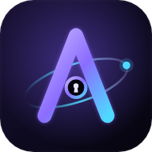

<p align="center"></p>

# Apoji Admin

The admin app for **Nexus '28** and **N28C**.
A Mac app (download it from Releases) and a website (GitHub Pages) that works from any browser or phone.

Only accounts in `public.admin_roles` can use it. Everything goes through Supabase row-level security.

## Mac app

Download the latest **Apoji-Admin-…-arm64.dmg** (Apple silicon) or **…-x64.dmg** (Intel) from [Releases](https://github.com/apojidelegraphics/Apoji-Admin/releases/latest), drag it to Applications, then run once:
```
xattr -cr "/Applications/Apoji Admin.app"
codesign --force --deep --sign - "/Applications/Apoji Admin.app"
```
It's the same portal with the files built in, plus a Dock badge for unread items, desktop notifications and an update check (Help → Check for Updates). To publish a new version, bump `version` in `package.json`, then push a tag like `v1.0.1`; GitHub Actions builds it and makes the release.

## What's inside

- **Dashboard**: active people (Mac app vs N28C), new accounts, Shared Space posts, versions in use, top agents, who's online and a live activity feed.
- **Admin chat**: pinned messages, group chats, DMs, images and files, replies, reactions, edits, @mentions, read receipts (with an off switch) and online / idle / do-not-disturb / invisible status. **End-to-end encrypted**; see below.
- **Inbox**: beta requests, feedback and bug reports (reply to people in their app, internal notes, assign, prioritize), and content reports.
- **Users**: search, filters, bulk beta/comp, CSV export, profiles with private notes, history, suspend/ban and roles.
- **Moderation**: every Shared Space, post and shared agent.
- **App control**: feature flags, announcements and maintenance switches the apps enforce.
- **Tasks**: the team's to-do board (To do · Doing · Done) with owners, due dates and priorities, linked to feedback, users or reports. Drag cards between columns.
- **Command palette**: ⌘K / Ctrl+K jumps to any page, admin, user, feedback report or task. `G` then a letter goes to a page, `N` makes a task, `?` lists every shortcut.
- **Saved replies**: your own snippets for feedback replies and chat (⚡).
- **Notifications**: pop-ups, desktop notifications, a chime and an app badge. Phone notifications through your Mac hub (below).
- **Team notes**: playbooks and how-tos, end-to-end encrypted like the chat, saved as you type, with a markdown preview and no silent overwrites.
- **Broadcasts**: a notification in everyone's Nexus Mac app and N28C (everyone, beta testers, admins or people on older versions), now or later.
- **Schedules**: turn announcements, maintenance and feature flags on or off at a set time.
- **Health**: Supabase speed, live updates, the Mac hub, N28C requests waiting, failed schedules, free AI key credit, database and storage size.
- **Releases**: downloads from GitHub, which versions people run and a one-click "please update" broadcast.
- **Axiom (Apex)**: high-admins only. Who can use Nexus '28 Axiom (BETA), weekly minutes, providers for the public, its prompt (stored only in Supabase) and who used how much.
- **Audit alerts**: a notification when another admin changes roles, bans someone or removes content.

## Mac hub (Tailscale)

Supabase stays the source of truth, so the website and the Mac app both work from anywhere. Turn on **This Mac → Use this Mac as the hub** and that Mac also:

- runs a small private API on your **tailnet only** (`tailscale serve` on port 8443, with a real HTTPS certificate). Every call needs a Tailscale account (optionally from an allow list) **and** a signed-in Apoji admin;
- sends **phone notifications** (web push from your Mac; phones only see "New message in #room" for chat unless you allow the text);
- runs **schedules** on time (every 30 seconds) and stays **awake** (only while plugged in, if you like). The screen can still turn off;
- opens at login and lives in the menu bar when you close the window (⌘Q quits).

The website finds the hub by itself. On a phone with Tailscale on, open the website → **Mac hub** → **Turn on notifications** (on iPhone, add the site to your Home Screen first). From there you can also run schedules right away and see what's new on the Mac. Without a hub, schedules run whenever any Apoji Admin is open.

Setup: install [Tailscale](https://tailscale.com/download) on the Mac and your phone (same account), and in the Tailscale admin console → DNS turn on **MagicDNS** and **HTTPS Certificates**.

## Encrypted admin chat

Messages and files are encrypted in your browser before they're sent (AES-256-GCM with a key derived from the team passphrase, PBKDF2-SHA-256 with 600,000 rounds). Supabase only stores scrambled text. Nobody can read the chat in the table editor, in backups or through the API without the passphrase, and the database refuses unencrypted messages.

- A high-admin sets the team passphrase the first time anyone opens Admin chat. Share it with admins in person.
- Each device asks for it once and keeps the key in that browser. *My settings → Lock* forgets it.
- *My settings → Encrypt messages from before* encrypts messages and files sent before encryption was turned on.
- If the passphrase is lost, encrypted messages can't be recovered by anyone.

## Setup

1. **SQL**: in Supabase → SQL Editor, run `supabase/apoji-admin.sql` (after Nexus' `nexus-v2.2.sql`), then `supabase/apoji-admin-1.1.sql`, then `supabase/apoji-admin-1.2.sql`.
2. **Encryption**: open **Admin chat** as a high-admin and set the team passphrase.
3. **Website**: Settings → Pages → Deploy from a branch → `main` / `(root)`.
4. **Hub** (optional): see above.

## Develop

Static files, no build step for the website. `npm install && npm start` runs the Mac app from source (`electron/`), `npm test` tests the hub. `crypto.js` is the encryption, `chat.js` the chat, `pages.js` most pages, `extras.js` tasks and the command palette, `features.js` the hub, notes, broadcasts, schedules, health and releases, `charts.js` small SVG charts and `admin.js` the shell (sign-in, theme, presence, realtime, notifications). `electron/hub-core.js` is the hub API, `electron/hub.js` keep-awake, login item and menu bar.
